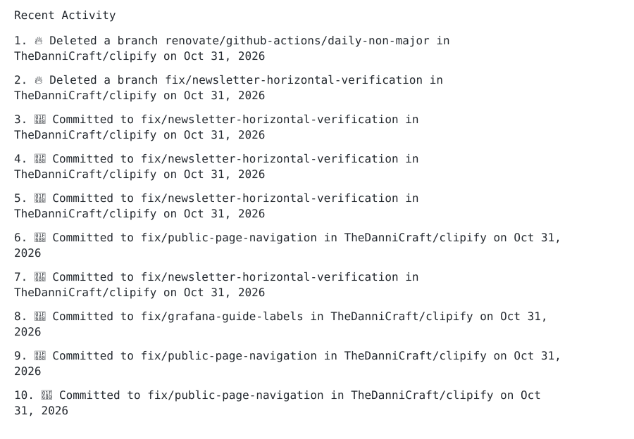

<h1 align="center" id="title">Activity Log</h1>


<p align="center">
    
    
    
    
    <!-- ALL-CONTRIBUTORS-BADGE:START - Do not remove or modify this section -->
<a href="#contributors"></a>
<!-- ALL-CONTRIBUTORS-BADGE:END -->
</p>

A GitHub Action that displays the latest activity from your GitHub account in a Markdown list, a table, or a standalone SVG image. Customize the displayed events, set a limit on the number of events, and ignore specific event types. Ideal for keeping your personal README file current with recent contributions and changes.

> [!WARNING]
> GitHub recently changed rate limits. See [Rate Limiting](#-rate-limiting) for more info.

## 📚 Project Docs

- [Contributing Guidelines](./CONTRIBUTING.md)
- [Security Policy](./SECURITY.md)
- [Support Guide](./SUPPORT.md)
- [Code of Conduct](./CODE_OF_CONDUCT.md)

## 🛠️Features

- Customizable Event Limits
- Event Filtering
- Flexibility with Inputs
- Customizable
- Dry Run Mode (preview changes without committing)
- Custom Commit Messages
- List, Table and SVG Output Modes
- Markdown or HTML Output Styles
- Optional Grouping of Repeated Pushes
- Hide Details on Private Repositories

## ✍️ Example

<!--START_SECTION:activity-->
1. 🚀 Committed to features/clip-export in [TheDanniCraft/clipify](https://github.com/TheDanniCraft/clipify/commit/4c8db350b38bcc1e219278096aabd30533a924fe) on Nov 5, 2026
2. 🚀 Committed to features/clip-export in [TheDanniCraft/clipify](https://github.com/TheDanniCraft/clipify/commit/a01e2dd8bda80732bd180e76383f31ceabb30640) on Nov 5, 2026
3. 🚀 Committed to feat/bootstrap-alpha-app in a private repository on Nov 5, 2026
4. 🚀 Committed to feat/bootstrap-alpha-app in a private repository on Nov 5, 2026
5. 🚀 Committed to feat/bootstrap-alpha-app in a private repository on Nov 5, 2026
6. 🚀 Committed to features/clip-export in [TheDanniCraft/clipify](https://github.com/TheDanniCraft/clipify/commit/5675e7dca82498961f70e6c056ebd70226803f8d) on Nov 5, 2026
7. 🚀 Committed to feat/bootstrap-alpha-app in a private repository on Nov 4, 2026
8. 🚀 Committed to features/clip-export in [TheDanniCraft/clipify](https://github.com/TheDanniCraft/clipify/commit/f9e5ca1d27d57c3d17055549c66beb9480b192a2) on Nov 5, 2026
9. 🚀 Committed to feat/bootstrap-alpha-app in a private repository on Nov 5, 2026
10. 🚀 Committed to feat/bootstrap-alpha-app in a private repository on Nov 5, 2026
<!--END_SECTION:activity-->

This repository keeps the linked Markdown list so individual event links work in
the README. Grouping reduces repeated entries; automated updates still edit this
section. SVG is optional and does not support interactive links when embedded.

## 📖Usage

### 1. Choose How to Display Activity

For the **default Markdown list**, add section markers to your README:

```markdown
<!--START_SECTION:activity-->
<!--END_SECTION:activity-->
```

For **SVG**, add an image link instead (no section markers needed):

```markdown

```

Choose the matching inputs in [Output Modes](#-output-modes). Keep one active
workflow and choose one output mode for it. This repository uses the default list option.

### 2. Create a Personal Access Token

<details open>
  <summary><strong>Quick Setup</strong> <i>(Recommended)</i></summary>

  1. To create a personal access token with the necessary permissions, click this [link to create a new token](https://github.com/settings/tokens/new?description=Github%20Activity%20Log%20(TheDanniCraft/activity-log)&scopes=repo). This link pre-fills the token description and scopes for your convenience.
  2. On the token creation page, review the pre-filled data and set the expiration date to "Never".
  3. Click "Generate token" and copy the token (be sure to save it as you won’t be able to see it again).

</details>

<details>
  <summary><strong>Manual Setup</strong></summary>

  1. Go to your GitHub [Personal Access Tokens settings](https://github.com/settings/tokens).
  2. Click on "Generate new token".
  3. Provide a descriptive name for the token, such as `Github Activity Log (TheDanniCraft/activity-log)`.
  4. Select the `repo` scope (recommended if you want private repo activity to show up).
  5. Set the expiration date to "Never".
  6. Click "Generate token" and copy the token (be sure to save it as you won’t be able to see it again).

</details>

### 3. Add the Token as a Repository Secret

1. Navigate to your GitHub repository.
2. Go to "Settings" > "Secrets and variables" > "Actions".
3. Click "New repository secret".
4. Name the secret (e.g., `TOKEN`).
5. Paste the personal access token into the value field.
6. Click "Add secret".

### 4. Create the Workflow File

Create a new file in your repository under `.github/workflows/`, for example, `activity-log.yml`. Add the following content to this file:

```yml
# .github/workflows/update-activity.yml:

name: Update GitHub Activity

on:
  schedule:
    - cron: "*/30 * * * *" # Runs every 30 minutes
  workflow_dispatch: # Allows manual triggering

jobs:
  update-activity:
    runs-on: ubuntu-latest
    steps:
      - uses: actions/checkout@v4
      - name: Update GitHub Activity
        uses: TheDanniCraft/activity-log@v1
        with:
          GITHUB_USERNAME: "thedannicraft"
          GITHUB_TOKEN: ${{ secrets.TOKEN }} # Ensure this matches the secret name in repository settings
```

Take a look at all possible [Inputs](#inputs) for customization

The above job runs every half an hour, you can change it as you wish based on the [cron syntax](https://crontab.guru).

Please note that only those public events that belong to the following list show up:

- `CreateEvent`
- `PushEvent`
- `IssuesEvent`
  - `opened`
  - `edited`
  - `closed`
  - `reopened`
  - `assigned`
  - `unassigned`
  - `labeled`
  - `unlabeled`
- `PullRequestEvent`
  - `opened`
  - `edited`
  - `closed`
  - `merged`
  - `reopened`
  - `assigned`
  - `unassigned`
  - `review_requested`
  - `review_request_removed`
  - `labeled`
  - `unlabeled`
  - `synchronize`
- `ReleaseEvent`
- `ForkEvent`
- `CommitCommentEvent`
- `IssueCommentEvent`
- `PullRequestReviewEvent`
- `PullRequestReviewCommentEvent`
- `RepositoryEvent`
- `WatchEvent`
- `StarEvent`
- `PublicEvent`
- `GollumEvent`

You can find an example [here](https://github.com/TheDanniCraft/activity-log/blob/master/.github/workflows/update-activity.yml).

### Inputs

| **Input**                       | **Description**                                                                                                                                                                 | **Required**     | **Default**                             | **Possible Options**                                                        |
|---------------------------------|---------------------------------------------------------------------------------------------------------------------------------------------------------------------------------|------------------|-----------------------------------------|-----------------------------------------------------------------------------|
| `GITHUB_USERNAME`               | Your GitHub username.                                                                                                                                                           | ✅               | `-`                                     | A valid GitHub username                                                     |
| `GITHUB_TOKEN`                  | Your GitHub token.                                                                                                                                                              | ✅               | `-`                                     | A valid GitHub access token (must belong to the specified GitHub username)  |
| `EVENT_LIMIT`                   | The maximum number of rows to display (after grouping, when enabled). See [Rate Limiting](#-rate-limiting).                                                                                                 | ❌               | `10`                                    | Any positive integer (250 max.)                                             |
| `OUTPUT_STYLE`                  | Specifies the format in which your output should be rendered. <br> <ins>Must be one of:</ins> <br> - `MARKDOWN`: Output in Markdown format <br> - `HTML`: Output in HTML format <br> - `SVG`: Standalone transparent SVG | ❌               | `MARKDOWN`                              | `MARKDOWN`, `HTML` or `SVG`                                                        |
| `IGNORE_EVENTS`                 | The events to ignore, specified as a JSON array.                                                                                                                                | ❌               | `[]`                                    | JSON array of event types (e.g., `["PushEvent", "PullRequestEvent"]`)       |
| `HIDE_DETAILS_ON_PRIVATE_REPOS` | Hide details (branch/tag name) on private repositories                                                                                                                          | ❌               | `false`                                 | `true` or `false`                                                           |
| `OUTPUT_MODE` | Layout: `list`, `table`, or `svg` (standalone image). | ❌ | `list` | `list`, `table`, `svg` |
| `OUTPUT_PATH` | Output file; takes precedence over `README_PATH`. | ❌ | `README.md` (`activity-log.svg` for SVG) | `.md` / `.markdown`, or `.svg` for SVG |
| `GROUP_EVENTS` | Combine repeated pushes to the same repository, branch, actor and visibility. | ❌ | `false` | `true`, `false` |
| `README_PATH`                   | Deprecated alias for `OUTPUT_PATH`.                                                                                                                                                   | ❌               | `README.md`                             | Any valid file path                                                         |
| `COMMIT_MESSAGE`                | Commit message used when updating the README file.                                                                                                                              | ❌               | `Update README.md with latest activity`  | Any valid commit message                                                    |
| `EVENT_EMOJI_MAP`               | Optional YAML object mapping event types to emojis. (See [🎨 Customizing Emojis](https://github.com/TheDanniCraft/activity-log#-customizing-emojis))                            | ❌               | `""`                                    | YAML object mapping event types to emojis                                   |
| `EVENT_TEMPLATE`                | Template used to render all events. Placeholders: `{emoji}`, `{event_type}`, `{action}`, `{subject}`, `{verb}`, `{repo}`, `{repo_url}`, `{date}`, `{number}`, `{url}`, `{ref}`, `{ref_type}`, `{count}`            | ❌              | `"{emoji} {action} {subject} {ref} {number} {verb} [{repo}]({url})"`                                    | Template string                                                             |
| `DRY_RUN`                       | Enable dry run mode (no changes will be committed)                                                                                                                              | ❌               | `false`                                 | `true` or `false`                                                           |

## 🎨 Customizing Emojis

You can personalize the emojis shown for each event type using the `EVENT_EMOJI_MAP` input. This input accepts a YAML object mapping event types (and subtypes) to your preferred emojis.

**Example usage in your workflow:**

```yaml
uses: TheDanniCraft/activity-log@v1
with:
  GITHUB_USERNAME: "thedannicraft"
  GITHUB_TOKEN: ${{ secrets.TOKEN }}
  EVENT_EMOJI_MAP: |
    PushEvent: "🚀"
    CreateEvent: "✨"
    DeleteEvent: "🔥"
    IssuesEvent: |
      opened: "🆕"
      closed: "✅"
```

Reference the `EVENT_EMOJI_MAP` input in the [Inputs](#inputs) table above for more details.

## 🖼️ Output Modes

Use the same workflow shown above and choose **one** configuration below. All
modes share templates, emojis, private-repository redaction and UTC dates.
`OUTPUT_PATH` overrides the deprecated `README_PATH` alias.

### Default: Markdown List

Existing workflows need no changes. The list replaces only the content between
the README activity markers.

```yaml
with:
  GITHUB_USERNAME: your-username
  GITHUB_TOKEN: ${{ secrets.TOKEN }}
  OUTPUT_MODE: list
  OUTPUT_STYLE: MARKDOWN
  OUTPUT_PATH: README.md
```

Example: `1. 📝 Committed to main in octocat/hello-world (3×)`.

### Table

Use the same README markers. The table has Date, Event, Repository and Description
columns. For an HTML list or HTML table inside Markdown, set `OUTPUT_STYLE: HTML`.

```yaml
with:
  GITHUB_USERNAME: your-username
  GITHUB_TOKEN: ${{ secrets.TOKEN }}
  OUTPUT_MODE: table
  OUTPUT_STYLE: MARKDOWN
  OUTPUT_PATH: README.md
```

### Optional SVG Image

SVG writes a standalone transparent image. The README embeds it once; later runs
commit changes to the image, avoiding repeated edits to the README. Text stays
selectable when the SVG is opened directly; an embedded image behaves as an image.
Links inside event descriptions become plain text in SVG. Browsers disable
interaction inside SVG images embedded with `` or Markdown image syntax;
adding anchors inside the SVG does not enable individual event links there.
Use list/table when clickable event links are required in the README. Long descriptions wrap, including long branch names. Wrapped lines align beneath the event text rather than the number column.

```yaml
with:
  GITHUB_USERNAME: your-username
  GITHUB_TOKEN: ${{ secrets.TOKEN }}
  OUTPUT_MODE: svg
  OUTPUT_PATH: activity-log.svg
  GROUP_EVENTS: 'true'
```

`OUTPUT_STYLE: SVG` also selects SVG output. SVG paths must end in `.svg`;
list/table paths must end in `.md` or `.markdown` and contain the section markers.
When paths are omitted, defaults are `README.md` or `activity-log.svg` for SVG.
No existing SVG file is needed. `OUTPUT_STYLE: SVG` cannot be combined with table mode.

For a separate automation repository, embed its raw image URL in your profile README:

```markdown

```

The action still commits the image into the repository and branch running the
workflow. Only the embedded image link is needed in the profile repository.
See [the single active reference workflow](.github/workflows/update-activity.yml).

### Group Repeated Pushes

Set `GROUP_EVENTS: 'true'` to combine pushes to the same repository and branch by
the same actor and visibility, including nonadjacent pushes. Groups keep the
newest position and commit link. Other event types stay separate so their subjects
and links are preserved. Ignored events and bot pushes are filtered first;
`EVENT_LIMIT` applies to rows **after** grouping. Grouping is off by default.

Grouping scans the available window, up to GitHub's last 300 events; it can use
more API requests than the ungrouped mode, which can stop once the limit is met.
Custom templates can use `{count}` (1 for an individual event). If omitted, grouped
rows append a count such as `(3×)`.

### Examples and Screenshots

Browse the committed [examples](examples/README.md) for list, table and SVG output,
with light/dark screenshots covering grouped pushes, issues, merged PRs, reviews,
comments, releases, branches, stars, forks, wiki edits, private activity and long
text. The SVG examples demonstrate image layout, not clickable embedded links.

Regenerate the examples manually from one offline fixture:

```bash
bun install --frozen-lockfile
bun run preview
bunx playwright install --with-deps chromium
bun run preview:screenshots
```

Open `examples/index.html` for a local comparison. These commands prepare events
once and render every mode with **zero GitHub API requests**. They write ordinary
files directly into `examples/`. There is no preview CI job or archive generation.
The HTML wrapper approximates Markdown presentation; GitHub's styling may vary.

To reuse a saved GitHub events JSON array:

```bash
bun run preview -- examples path/to/events.json
```

Application code can call `fetchActivityRows()` once and pass the returned rows
to `formatActivity()` for each mode. Rendering requires no further API calls;
only the selected production mode is committed by the scheduled workflow.
For a production preview without committing, use `DRY_RUN: 'true'` (fetches real events).

## 🎯 Custom Event Templates

You can customize event rendering with one global template using `EVENT_TEMPLATE`.

Supported placeholders:

- `{count}`: Number of grouped events (1 for an individual event)
- `{emoji}`: Event emoji from the default map or `EVENT_EMOJI_MAP` (example: `🚀`)
- `{event_type}`: Raw GitHub event type (example: `PushEvent`)
- `{action}`: Human-readable action text (example: `Committed`, `Opened`, `Merged`)
- `{subject}`: Event object for readable phrasing (example: `PR`, `issue`, `commit`, `release`)
- `{verb}`: Connector based on legacy phrasing (example: `to`, `in`, or empty)
- `{repo}`: Repository name (or `a private repository` for private events)
- `{repo_url}`: Repository URL (example: `https://github.com/TheDanniCraft/activity-log`)
- `{date}`: Formatted event date in UTC (example: `Mar 10, 2026`)
- `{number}`: Issue/PR number when available (example: `#110`)
- `{url}`: Link to the related resource (commit/comment/review/PR/issue/release when available, otherwise the repository URL for public events)
- `{ref}`: Branch/tag ref when available (example: `main`, `v1.2.0`)
- `{ref_type}`: Ref type for create/delete events (example: `branch`, `tag`, `repository`)

Example:

```yaml
EVENT_TEMPLATE: "{emoji} {action} {subject} {ref} {number} {verb} [{repo}]({url})"
```

## ⚠️ Rate Limiting

GitHub has API rate limits. They are documented here:

- [REST API rate limits](https://docs.github.com/rest/using-the-rest-api/rate-limits-for-the-rest-api)
- [Secondary rate limits](https://docs.github.com/rest/using-the-rest-api/rate-limits-for-the-rest-api#about-secondary-rate-limits)

This action respects these limits by design:

- It waits and retries using GitHub's `retry-after` values.
- It stands down/backs off when GitHub signals throttling.
- It may run longer in heavy cases instead of failing immediately.

## 📜License

[MIT](https://choosealicense.com/licenses/mit/)

## ✍️Authors

- [@thedannicraft](https://www.github.com/thedannicraft)

## ✨Contributors 

Thanks goes to these wonderful people: [Emoji key for contribution types](https://allcontributors.org/docs/en/emoji-key).

<!-- ALL-CONTRIBUTORS-LIST:START - Do not remove or modify this section -->
<!-- prettier-ignore-start -->
<!-- markdownlint-disable -->
<table>
  <tbody>
    <tr>
      <td align="center" valign="top" width="14.28%"><a href="https://leetcode.com/u/_theRJ_/"><br /><sub><b>Rounak Joshi</b></sub></a><br /><a href="https://github.com/TheDanniCraft/activity-log/commits?author=RounakJoshi09" title="Documentation">📖</a> <a href="https://github.com/TheDanniCraft/activity-log/commits?author=RounakJoshi09" title="Code">💻</a> <a href="https://github.com/TheDanniCraft/activity-log/commits?author=RounakJoshi09" title="Tests">⚠️</a></td>
      <td align="center" valign="top" width="14.28%"><a href="https://github.com/gltched-usr"><br /><sub><b>Glched</b></sub></a><br /><a href="https://github.com/TheDanniCraft/activity-log/issues?q=author%3Agltched-usr" title="Bug reports">🐛</a> <a href="https://github.com/TheDanniCraft/activity-log/commits?author=gltched-usr" title="Documentation">📖</a></td>
    </tr>
  </tbody>
</table>

<!-- markdownlint-restore -->
<!-- prettier-ignore-end -->

<!-- ALL-CONTRIBUTORS-LIST:END -->

This project follows the [all-contributors](https://github.com/all-contributors/all-contributors) specification. Contributions of any kind welcome!

## 📝 Blog Posts

<table>
  <tr>
    <td>
      <a href="https://thedannicraft.blog/how-to-automate-your-github-readme/">
        
      </a>
    </td>
    <td>
      <a href="https://thedannicraft.blog/how-to-automate-your-github-readme/">How to automate your GitHub README</a><br/>Oct 23, 2025 • by TheDanniCraft
    </td>
  </tr>
</table>

Wrote a blog post about activity-log? [Open an issue](https://github.com/TheDanniCraft/activity-log/issues/new) and share the article link.
