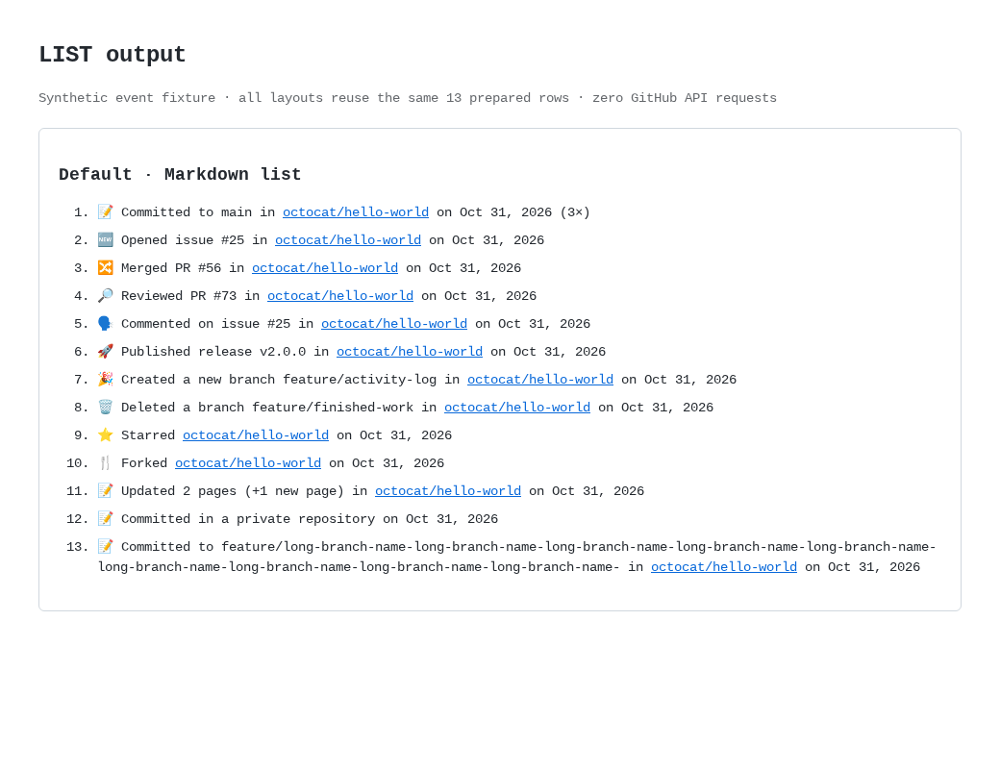
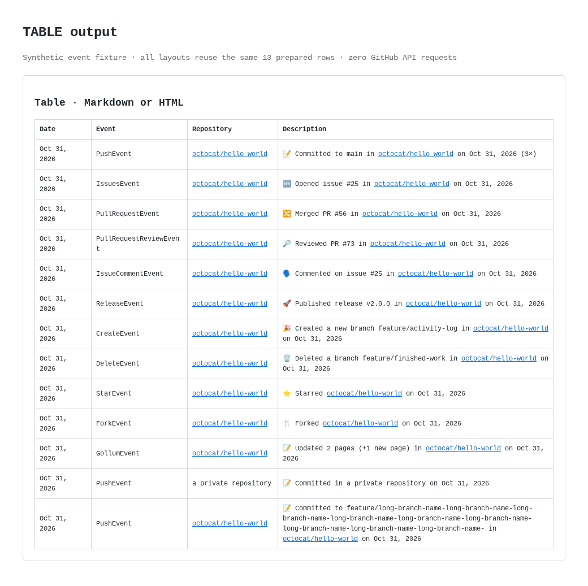
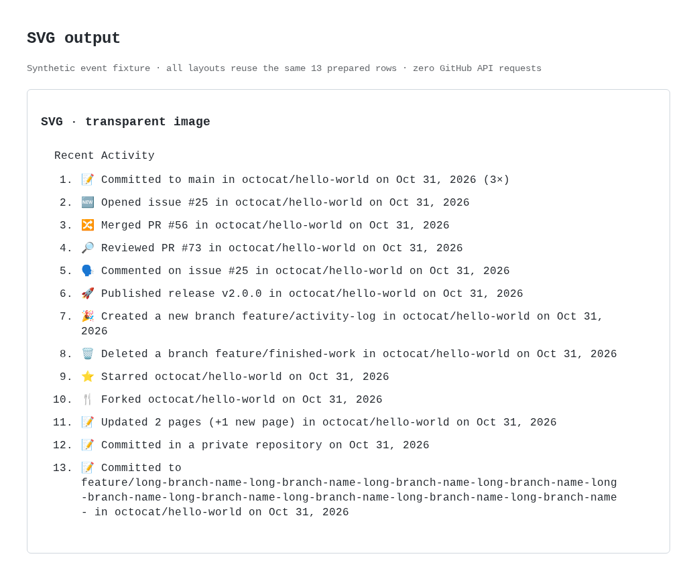

# Activity log examples

These examples use one synthetic event fixture, prepared once by the production
renderer. They do not fetch GitHub data. List/table outputs preserve clickable
event links. SVG output is an image: links within an embedded image cannot be
clicked, so this repository uses the Markdown list in its README.

| Mode | Rendered output | Generated source | Light screenshot | Dark screenshot |
| --- | --- | --- | --- | --- |
| Default list | [Markdown list](list.md) | [HTML fragment](list-fragment.html) | [View](list-light.png) | [View](list-dark.png) |
| Table | [Markdown table](table.md) | [HTML fragment](table-fragment.html) | [View](table-light.png) | [View](table-dark.png) |
| Optional SVG | [Image](activity.svg) | [SVG source](activity.svg?plain=1) | [View](svg-light.png) | [View](svg-dark.png) |

## Default list



## Table



## SVG wrapping

Continuation lines align beneath the event text; the numbers have their own
column. SVG screenshots show appearance only, with no interactive image links.



The fixture covers nonadjacent grouped pushes, issues, merged PRs, reviews,
comments, releases, branch creation/deletion, stars, forks, wiki edits, private
activity and an unusually long branch name. The examples are synthetic and do not
claim that the referenced issues or commits exist.

To regenerate from the repository root:

```bash
bun run preview
bunx playwright install --with-deps chromium
bun run preview:screenshots
```

Open `examples/index.html` locally for the comparison. Screenshots use a local
HTML wrapper; GitHub's exact Markdown styling can differ. The screenshot script
also checks SVG bounds, line spacing, and hanging indentation. There is no CI
preview job and no ZIP or other archive generation.
